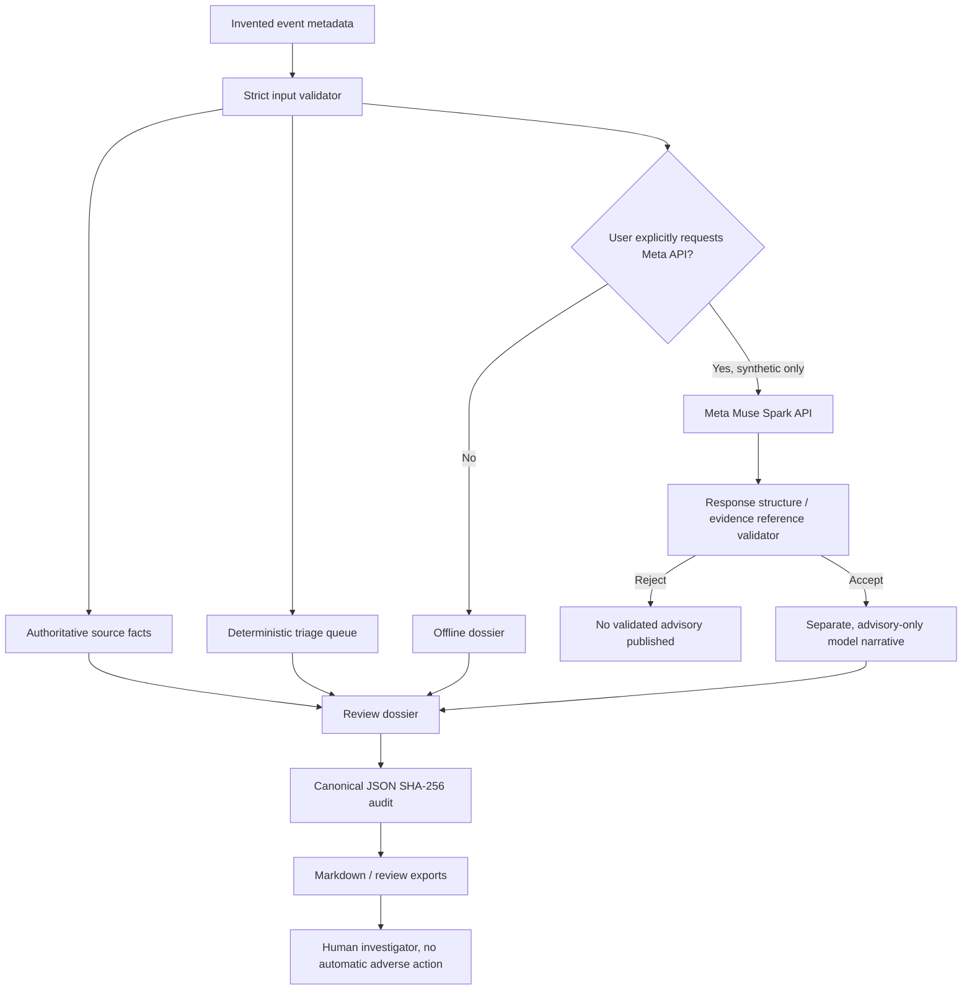

# VoiceID Sentinel v1.6 — Architecture, trust boundaries and threat model

**Scope:** Synthetic local workbench, not bank production. Do not confuse VoiceID voiceprint embeddings (256-dimensional feature vectors) with SHA-256 cryptographic data hashes (256-bit digests).

## Architecture

## Five trust boundaries

1. **Metadata input:** strict schema, synthetic-only classification, event count, timestamp, allowed field names; still cannot prove original records are not real.
2. **Biometric authority:** source authentication outcomes are read-only; the model does not change verification, liveness or replay status, or calculate triage priority.
3. **Model boundary:** explicit opt-in key handling, no tool invocation or direct account action, structured output/reference validation and some high-risk phrase checks. This does **not** fully detect hallucination or prompt injection.
4. **Human decision:** investigation data supports analysis, not a fraud verdict, denial, suspension or identity assignment.
5. **Audit boundary:** SHA-256 matches compare canonical JSON bytes; no signer, independent time-stamp service, tamper-proof journal, append-only evidentiary storage or provenance chain.

## Selected threat scenarios and controls

| Threat | Current synthetic-demo control | Residual exposure |
|---|---|---|
| Forged shared human identity claim | Equal opaque token only yields a qualified correlation signal | LLM prose can be misleading; human review remains necessary |
| AI changes original event timestamp | Timestamp matching required | Source logs themselves are not attested |
| Model suggests automatic account freeze | Known high-risk phrasing rejected; no actions/tool connectors | Unknown paraphrases may evade static rules |
| Malformed or excessive input | JSON duplicate checks, bounded body, schema whitelist | Synthetic label does not establish actual privacy status |
| Accidental API spend | `--enable-meta` plus per-request browser confirmation | Key owner must monitor credits and billing |
| CSRF from external websites | Localhost-only bind, Origin/Host checks, session token in header, restrictive CSP | Not intended for untrusted multi-user hosting |
| Changed exported dossier | Hash mismatch against unchanged audit JSON | If attacker changes both, pair may again appear consistent |
| Exfiltration via browser UI | textContent for model text, same-origin CSP, no third-party assets | External provider receives the user-authorized synthetic case in live mode |

## Production architecture still required

A controlled enterprise build should have a non-public authentication gateway, per-tenant authorization, mTLS/TLS, secrets manager, audited role-based access, immutable event storage/signatures, encrypted data-at-rest, privacy controls, rate limits, API usage quotas, evidence retention policy, observability, disaster recovery and independently tested controls. These features **are not implemented** by the local hackathon prototype.
